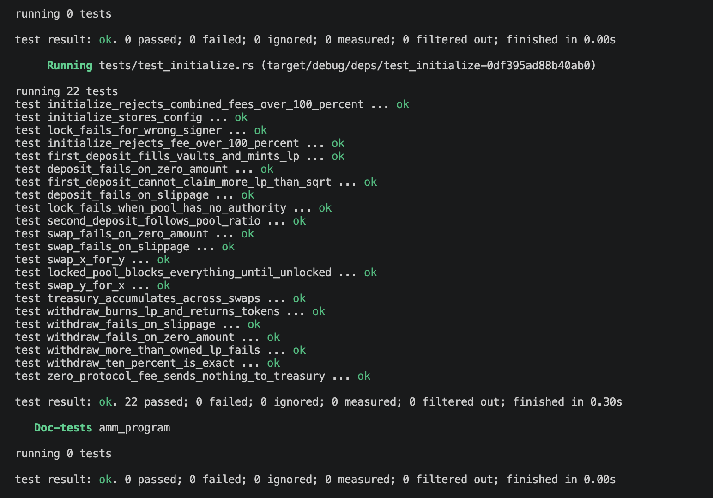

# AMM Program (Anchor / Solana)

A constant-product AMM (`x * y = k`) for two SPL tokens, with LP tokens, a swap fee for liquidity providers, and a protocol fee paid to a treasury. The swap, deposit and withdraw math is written from scratch (no curve library).

## Instructions

| Instruction | What it does |
|---|---|
| `initialize(seed, fee, protocol_fee, authority)` | Creates the pool: config PDA, LP mint, two vaults, and two treasury token accounts. Rejects `fee + protocol_fee > 10_000` bps. |
| `deposit(amount, max_x, max_y)` | Adds liquidity and mints LP tokens. `amount` is the LP to receive; `max_x` / `max_y` cap what the user will pay (slippage). |
| `withdraw(amount, min_x, min_y)` | Burns LP tokens and returns the user's share of both vaults. `min_x` / `min_y` are the slippage floor. |
| `swap(amount, min_amount, is_x)` | Swaps `amount` of one token for the other. `is_x = true` means X in, Y out. |
| `lock` / `unlock` | The pool authority freezes or unfreezes deposits, withdrawals and swaps. |

## Accounts (PDAs)

- **Config**: seeds `["config", seed (u64, LE)]`. Stores mints, `fee`, `protocol_fee`, `treasury`, `authority`, `locked` and bumps. It is the authority of the vaults and the LP mint.
- **LP mint**: seeds `["lp", config]`, 6 decimals.
- **Vaults**: associated token accounts of the config PDA, one per mint.
- **Treasury accounts**: associated token accounts owned by the treasury wallet stored in Config, one per mint. They are not PDAs, so whoever holds the treasury wallet withdraws with an ordinary token transfer.

## Math

All arithmetic uses `u128` with checked operations.

- **First deposit**: LP minted = `isqrt(x * y)`. The `amount` argument is the minimum LP the depositor accepts, so nobody can claim more LP than the deposit is worth.
- **Later deposits**: required `x = ceil(vault_x * amount / supply)`, same for `y`. Rounding up means the pool never loses.
- **Withdraw**: `x = floor(vault_x * amount / supply)`, same for `y`. Rounding down means the pool never loses. Payouts are computed before the LP burn, because the burn changes the supply.
- **Swap**:
  1. `protocol_cut = amount * protocol_fee / 10_000`, paid in the input token to the treasury.
  2. `net = amount - protocol_cut`.
  3. `in_after_fee = net * (10_000 - fee) / 10_000`.
  4. `out = reserve_out * in_after_fee / (reserve_in + in_after_fee)`, rounded down.
  5. The user pays `amount` in total; the vault receives `net`; the user receives `out`.

The LP fee is not transferred anywhere. It stays in the vault, so `k` grows with every swap and LPs earn through the value of their LP tokens.

## Tests

LiteSVM integration tests in `programs/amm-program/tests/test_initialize.rs` cover every instruction, success and failure paths: config contents, fee validation, first and later deposits, slippage, zero amounts, withdrawing more than owned, swaps in both directions with a check that `k` never decreases, treasury balances, and lock/unlock with authority checks.

```
anchor build   # tests load target/deploy/amm_program.so
anchor test
```

### Test results

<!-- TODO: run `anchor test`, save a screenshot of the passing output as docs/test-results.png -->


## Findings during development

- The `constant-product-curve` library's `xy_*_from_l` functions take `precision` as a multiplier, not a number of decimals. Passing `6` made deposits mint LP for almost nothing and made partial withdrawals pay out too much. This was caught by tests and is gone now that the math is written directly.
- The same library never deducts the fee in its Y-to-X swap branch and rounds in the user's favor, so `k` could decrease. Also caught by a test.

## Known limitations

- No permanently locked minimum liquidity on the first deposit, so an empty pool is exposed to share-price inflation by donation.
- `authority` is a single optional key, and the treasury address cannot change after `initialize`. A real deployment should use multisigs for both.
- While locked, withdrawals are blocked too. That protects LPs during an exploit but would trap them if the authority disappeared.
- There is no transaction deadline. Slippage limits are the only protection against late-landing transactions.

## Extension: downtime

See [`DOWNTIME.md`](./DOWNTIME.md) for how to mitigate downtime in DeFi applications.